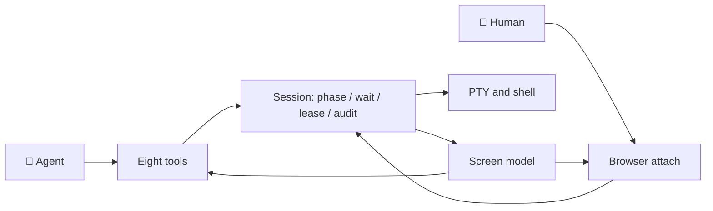

<h1 align="center">🖥️ Agent Interactive Terminal</h1>

<p align="center">Stateful terminal sessions on a real PTY, shared by an agent and a person in front of the same screen.</p>

<p align="center">
  🌐 <a href="README.md">简体中文</a> · <b>English</b>
</p>

<p align="center">
  <a href="https://github.com/AyanamiiiRei/agent-interactive-terminal/actions/workflows/ci.yml"></a>
  <a href="LICENSE"></a>
  <a href="package.json"></a>
  
  <a href="https://github.com/AyanamiiiRei/agent-interactive-terminal/stargazers"></a>
</p>

> **Status.** M1 is in place, the M2 session layer (control lease, password
> suspension, secret injection) has landed, and M3's shell fidelity and session
> capsule are done. Fifty tests pass on Linux with Node 20 and Node 22.
> The repository also ships as a DSH bundle listed in a plugin market index.
> Open items are tracked in [ROADMAP.md](ROADMAP.md).

## ✨ Why this exists

Every terminal an agent can call today is really `exec`: spawn a child process,
wait for it to exit, collect stdout and stderr. That model is stateless,
one-shot, and pipe based. It has no TTY, so programs never enter interactive
mode, shell startup files are not loaded the way a person would expect, long
tasks show no progress, and a human cannot work in the same terminal as the
agent without copying text back and forth.

The usual workarounds all fail in the same place. Feeding `yes` into stdin is
not the same as answering a prompt. Polling a pipe for a password prompt leaks
the password into the transcript. Waiting for silence cannot tell a finished
command from a slow one, and no amount of parsing raw ANSI bytes gives the
agent a picture of what is currently on screen.

This project turns a terminal session into a resource with an identity, a
screen, a phase, and a control lease, so the agent reads discrete screen
snapshots instead of subscribing to a byte stream.

## 🧩 As a DeepSeek Harness plugin

This repository is also a DeepSeek Harness bundle. Once enabled, it registers
the eight `terminal_*` tools for every agent in the current profile and adds a
configuration card on the Plugins page: the default shell can follow `$SHELL`,
or be pinned to `zsh` or `bash`, and the number of concurrent sessions defaults
to four.

Add this index on the Discover tab of the Plugins page:

```text
https://raw.githubusercontent.com/AyanamiiiRei/agent-interactive-terminal/main/plugin-market.json
```

Then search for `agent-interactive-terminal` and install it. You can also skip
the market and paste the Git spec into Add plugin:

```bash
git+https://github.com/AyanamiiiRei/agent-interactive-terminal.git#bd6c936d82fcc0be19495b552dd69696f84d3f6d
```

The installer asks you to approve the `node-pty` build script, which compiles the
native module. The plugin market itself is an experimental DSH bundle and needs a
DSH restart the first time it is enabled; the terminal plugin is an ordinary bundle row and
is loaded by the loader. Changing the shell in the configuration card affects
only sessions opened afterwards; existing sessions keep their shell. After
upgrading to 0.3.0, restart DSH once: the attach WebSocket route is registered at
Host startup, and the browser chunk enters the module table at startup too.

### 🖥️ The shared terminal panel

With the plugin enabled, the session header above the conversation gets a
terminal icon. Clicking it opens a real terminal in the right sidebar:
xterm.js owns the keyboard, and there is no extra input line and no Send
button. One tab is one Host session. Opening a tab spawns a shell immediately
and attaches to that PTY; closing the tab stops its process tree, and when the
shell exits on its own the tab closes itself after a moment. Clicking the
header icon again focuses the tab already bound to the newest session instead
of stacking a second view.

The keyboard is not gated behind a button. Clicking into the terminal only moves
focus; the lease follows an actual keystroke, and the banner switches to "You
have control" at that moment. A few seconds after your last key (four by
default) the lease goes back to the agent on its own, the banner returns to
"Agent is driving", and the thin line under the bar shows how long is left. When
you want to rule out accidental typing entirely, the lock button in the header
drops every key while selection, copying, and scrolling keep working; the lock
is remembered across reloads. A credential prompt turns the banner red and asks
for your password, which never enters the model's context. The agent reads the
same screen with `terminal_snapshot`, and whatever the agent writes appears here
immediately. A closed browser also returns the lease, so the agent is never
locked out.

Keyboard input, clipboard, and resizing use the WebSocket attach stream.
Selecting text copies it, Ctrl+Shift+V or a right click pastes with bracketed
paste, and a window resize refits the terminal and sends the new size to the
PTY. The shortcuts follow Ptyxis: Ctrl+Shift+T opens a tab, Ctrl+Shift+W closes
it, Ctrl+Shift+C/V copy and paste, and Ctrl+=, Ctrl+-, Ctrl+0 zoom the font.

The gear button opens a settings sheet: seven themes (Dark, Light, Solarized
Dark and Light, Dracula, One Dark, GNOME, Tango, each with a full 16-color ANSI
palette), font family, size, line height, weight, ligatures, cursor shape and
blink, scrollback, bell, copy-on-select, right-click paste, the idle delay after
which control returns to the agent, and a shortcut table where every binding can
be recorded again. Changes apply immediately and persist
in localStorage, with a restores-defaults button at the bottom. The sheet is an
overlay inside the terminal, never a modal dialog.

The configuration card also gained a "default execution surface" choice.
"Interactive terminal first" adds a system-prompt section that steers the
agent toward the shared terminal for REPLs, package managers, database clients,
and similar work; "one-shot commands first" steers it back. Auto adds no
guidance and leaves the choice to the model.

## 🚀 Quick start

Requires Node.js 20 or newer and a C++ toolchain for `node-pty`. Development
and CI target Linux: foreground-process inspection uses `/proc`, and macOS and
Windows are not verified yet.

```bash
# Clone and install
git clone https://github.com/AyanamiiiRei/agent-interactive-terminal.git
cd agent-interactive-terminal
npm install
npm test

# Run one command and see the screen and status line the model gets
npm run demo -- "git status"

# Interactive loop: type commands, plus /snap, /wait, /key, /resize, /quit
npm run demo

# Browser attach: open the address printed in the terminal
npm run attach
```

The demo loop looks like this:

```text
› ls
› /snap
› /wait 5000
› /key ctrl-c
› /resize 120 40
› /quit
```

## 🧰 Use it from code

The library has no agent-framework dependency. Use the session directly when you
know what to wait for:

```ts
import { TerminalRegistry } from 'agent-interactive-terminal'

const sessions = new TerminalRegistry({ maxSessions: 2 })
const session = await sessions.open({ name: 'build', cols: 100, rows: 30 })

await session.write('npm run dev')
const result = await session.wait({ match: ['ready in'], timeoutMs: 60_000 })
console.log(result.outcome, result.phase)
console.log(result.view.text)

await session.close()
```

Or register the tool definitions with your own model runtime:

```ts
import { createTerminalTools, toolIndex, TerminalRegistry } from 'agent-interactive-terminal'

const registry = new TerminalRegistry()
const tools = toolIndex(createTerminalTools(registry))
// Expose each tool's name, description, and parameters schema to the model,
// then dispatch calls through tools.get(name).execute(args).
```

### 🤝 Human in the loop

The lease decides who owns the keyboard. A person can take over at any time; the
agent then gets `LEASE_DENIED` on writes and `human_took_over` from a wait, and
cannot take control back on its own:

```ts
session.takeOver()                     // the person is driving now
await session.write('ls', { origin: 'human' })
session.handBack()                     // the person gives it back
```

When a credential prompt appears, the session suspends the agent, settles the
pending wait with `human_required`, and holds the lease until a person answers:

```ts
const asked = await session.wait({ timeoutMs: 30_000 })
if (asked.outcome === 'human_required') {
  // Show the prompt to the human. Never ask the model for the secret.
  await session.write(secretFromHuman, { origin: 'human' })
}
```

Secrets can be injected at spawn time, so a value never crosses the terminal:

```ts
const session = await sessions.open({
  secrets: { GITHUB_TOKEN: () => readCredential('github') },
})
```

### 🌐 Browser attach

`npm run attach` starts a local demo that renders the same session in a browser
through xterm.js and a WebSocket. The page is read-only until you press "Take
over"; from then on keystrokes go through `session.write(..., { origin: 'human' })`,
and "Hand back" returns the keyboard to the agent. The demo server binds to
`127.0.0.1`, serves xterm.js from `node_modules`, and has no authentication, so
treat it as an example rather than a deployment.

## 📦 What works today

- 🖥️ A real PTY per session, launched from `$SHELL` (or an explicit path), with
  `TERM=xterm-256color`, the working directory, and extra environment entries.
- 🧠 A headless xterm screen model with alternate-screen handling, scrollback,
  soft-wrap joining, cursor and title tracking, and removal of shell ghost text
  drawn after the cursor in dim cells.
- 🎯 Two projections from one screen: a text screen for the model and a serialized
  ANSI snapshot for the browser attach stream.
- 🚦 Phases `starting`, `running`, `waiting_input`, `idle`, and `exited`. Bash
  and zsh get prompt markers installed after their own startup files, through a
  wrapper rcfile that preserves the user's configuration; fish and other shells
  fall back to foreground-process inspection plus a short quiet window.
- ⏳ A wait engine with literal matches, quiet time, phase settling, timeout, and
  exit, evaluated in a fixed priority order, plus Ctrl-C style interrupts and
  bracketed paste.
- ⌨️ Named keys including interrupt, EOF, suspend, arrows, paging, and common
  Ctrl chords, plus resize and process-tree cleanup on close.
- 🔒 A single-writer lease with human takeover and handback, password-prompt
  detection that suspends the agent and settles waits with `human_required`, and
  secret injection at spawn time.
- 🧾 An audit record for every write and control change, with secret input
  redacted.
- 🧩 A per-turn capsule from `registry.capsule()`: a short line per session plus
  a version that changes only when the summary changes.
- 🌐 A browser attach demo that shares one live session with xterm.js, read-only
  until a person takes over.
- 🖥️ A real terminal in the right sidebar: xterm.js over a WebSocket attach
  stream, with themes, fonts, cursor, scrollback, bell, clipboard options, a
  rebindable shortcut table, and a lease banner that separates "Agent is
  driving" from "You have control".
- 🧪 Fifty tests covering the screen model, session lifecycle, shell
  integration, lease, secrets, audit, capsule, tools, and the attach stream.

## 🧩 The eight tools

| Tool | What it does |
| --- | --- |
| `terminal_open` | Open a session and return its id, status line, and initial screen |
| `terminal_send` | Write text (Enter submits by default) and wait for a settle condition |
| `terminal_wait` | Wait without writing |
| `terminal_snapshot` | Read the current screen or output tail, optionally as a diff from a revision |
| `terminal_key` | Press a named key such as `ctrl-c`, `enter`, or `page-down` |
| `terminal_resize` | Resize the terminal |
| `terminal_close` | Close the session and stop its process tree |
| `terminal_list` | List open sessions with phase, size, and directory |

## 🏗️ Design at a glance



The design is organised in five layers:

1. **PTY primitives**: spawn, write, resize, signal, foreground process
   inspection, process tree cleanup.
2. **Session core**: one screen model per session, activity tracking, waiters,
   control lease, redaction, audit.
3. **Session service**: identity, publication, authorization, cleanup, and
   change events.
4. **Tool surface**: a small set of model-facing tools that write, wait, read
   the screen, press keys, resize, and close.
5. **Transport and UI**: an attach stream for a browser terminal, sharing the
   same session record as the agent.

Three invariants hold across the layers. There is one screen model and two
projections, text for the agent and serialized ANSI for the browser. Writing is
an action, waiting is a query, and state is a fact, kept separate so a long task
can be observed without being written to. Authority is granted when a session is
created rather than re-approved on every keystroke.

The full design, including tool schemas, data structures, the lease protocol,
and the list of sharp edges, is in [docs/design.zh.md](docs/design.zh.md). The
document is written in Chinese; an English translation is welcome.

## 🗂️ Repository layout

```text
src/screen/model.ts      Headless xterm screen model and both projections
src/pty/pty.ts           node-pty wrapper
src/pty/proc.ts          Linux foreground group and stdin-wait inspection
src/session/session.ts   TerminalSession: write, wait, key, snapshot, lease, audit
src/session/registry.ts  Session ids, limits, lookup, cleanup, and the capsule
src/session/shell.ts     $SHELL resolution and bash/zsh startup wrappers
src/tools/index.ts       Eight model-facing tool definitions
src/cli/demo.ts          Interactive demo over the tool surface
test/                    Screen, session, shell, lease, capsule, and tool tests
docs/design.zh.md        Full design document
ROADMAP.md               Milestones, scope, and explicit non-goals
```

## 🗺️ Status and roadmap

M1 covers a single agent with a readable screen and waits that settle for the
right reason. M2 adds the shared session, the lease, and password handoff. M3
polishes shell fidelity and multi-session context. [ROADMAP.md](ROADMAP.md) lists
every item and every deliberate non-goal.

Not yet implemented: redaction spans beyond the audit preview, idle session
reclamation, a wake-on-pattern channel for an idle agent, fish integration, and
Windows and macOS parity.

## 📚 Related work

The design was written against DeepSeek Harness and builds on primitives that
already exist there: a node-pty based terminal spawner, an owner-scoped session
registry, a shell backend with prompt markers, a headless xterm screen, a duplex
attach stream, and a background job channel that can wake an idle agent. The
proposal is to unify those pieces behind one session model rather than to
replace them.

Prior art worth reading includes tmux and screen for session multiplexing,
expect for scripted interaction, and the PTY and terminal emulation work in
libvterm, xterm.js, and pyte.

## 🛠️ Contributing

Issues and design comments are welcome, especially from people who have built
agent tooling or terminal multiplexers. If you want to implement a milestone,
open an issue first so the scope stays aligned with the roadmap.

## 📄 License

MIT. See [LICENSE](LICENSE).

<p align="center">If this project saves you some work, a ⭐ is the best way to say thanks.</p>

<p align="center">🌐 <a href="README.md">阅读中文版</a></p>
