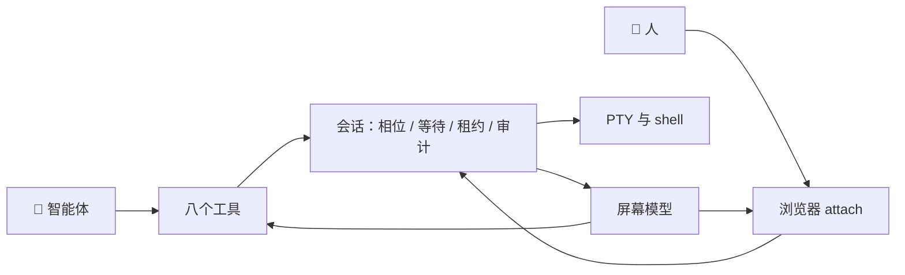

<h1 align="center">🖥️ Agent Interactive Terminal</h1>

<p align="center">有状态、跑在真实 PTY 上的终端会话，让智能体和人在同一块屏幕前协作。</p>

<p align="center">
  🌐 <b>简体中文</b> · <a href="README.en.md">English</a>
</p>

<p align="center">
  <a href="https://github.com/AyanamiiiRei/agent-interactive-terminal/actions/workflows/ci.yml"></a>
  <a href="LICENSE"></a>
  <a href="package.json"></a>
  
  <a href="https://github.com/AyanamiiiRei/agent-interactive-terminal/stargazers"></a>
</p>

> **状态**：M1 的主体、M2 的会话层（控制租约、密码挂起、密钥注入）、M3 的 shell
> 保真和会话胶囊都已经落地，右侧边栏的 xterm 终端也已经接上同一条 attach 流，
> 四十九个测试在 Linux 的 Node 20 和 Node 22 上通过。仓库同时以 DSH bundle 的形式
> 发布，并进入了插件市场索引。还没做的条目在 [ROADMAP.md](ROADMAP.md)。

## ✨ 为什么需要它

今天智能体能够调用的“终端”，本质上都是 `exec`：启动子进程、等它退出、收集
stdout 和 stderr。这个模型是无状态的、一次性的、基于管道的。它没有 TTY，所以
程序不会进入交互模式，shell 的启动配置不会按人的预期加载，长任务看不到过程，
人和智能体也没法在同一个终端里协作，只能靠复制粘贴。

常见的绕法都卡在同一个地方。往 stdin 里灌 `yes` 不等于回答提示；轮询管道等密码
提示，会把密码泄漏进对话记录；等输出安静区分不了“跑完了”和“跑得慢”；而无论
怎么解析 ANSI 字节，智能体都拿不到“此刻屏幕上是什么”。

这个项目把终端会话变成一份有身份、有屏幕、有相位、有控制租约的资源，让智能体
读取离散的屏幕快照，而不是订阅一条字节流。

## 🧩 作为 DSH 插件

这个仓库同时是一个 DeepSeek Harness 的 bundle。启用之后，它向当前 profile 里的
每个智能体注册八个 `terminal_*` 工具，并且在 Plugins 页给出一张配置卡：默认 shell
可以选跟随 `$SHELL` 的自动模式、`zsh` 或者 `bash`，同时打开的会话数默认是四。

在 Plugins 的 Discover 标签页里添加这个索引：

```text
https://raw.githubusercontent.com/AyanamiiiRei/agent-interactive-terminal/main/plugin-market.json
```

然后搜索 `agent-interactive-terminal` 安装。也可以跳过市场，在 Add plugin 里直接
填 Git 规格：

```bash
git+https://github.com/AyanamiiiRei/agent-interactive-terminal.git#87ff10ed19b097087ab98f15f8ca8c4d738be280
```

安装时会提示批准 `node-pty` 的构建脚本，同意之后才会编译出原生模块。插件市场
本身是 DSH 的实验性 bundle，第一次启用需要重启 DSH；终端插件是普通的 bundle
行，装好之后由 loader 加载。配置卡里改的 shell 只影响之后新开的会话，已经
打开的会话保持原来的 shell。从旧版本升级到 0.3.0 之后要重启一次 DSH：attach 的
WebSocket 路由在 Host 启动时注册，浏览器半边的 chunk 也在启动时进入模块表。

### 🖥️ 共享终端面板

启用之后，对话页会话标题栏会出现一个终端图标。点它，右侧边栏会打开一个真正的
终端：xterm.js 直接接管键盘，没有额外的输入框，也没有“发送”按钮。标签页和 Host
上的一条会话一一对应，打开标签页就立刻启动 shell 并接上同一条 PTY，关掉标签页
就终止整棵进程树；shell 自己退出时，标签页会在片刻之后自动关闭。重复点标题栏的
图标会聚焦已经绑定到最新会话的标签页，不会叠出第二份视图。

面板顶部是一条租约横幅。Agent 持有控制权时显示“Agent 正在操作”，键盘输入被拦下，
点“接管输入”之后才能打字，交还时点“交还控制”。出现密码提示时横幅变红，显示
“需要你输入密码”，你输入的内容不会进入模型的上下文。你敲的每条命令，agent 下一轮
用 `terminal_snapshot` 看到的都是同一块屏幕；agent 写进去的东西，你也会立刻在面板
里看到。

键盘、复制粘贴和尺寸变化都走 WebSocket attach 流。选中文本即复制，Ctrl+Shift+V
或右键粘贴走括号粘贴，窗口变化时自动 fit 并向 PTY 发 resize。快捷键沿用 Ptyxis
的习惯：Ctrl+Shift+T 新建，Ctrl+Shift+W 关闭，Ctrl+Shift+C/V 复制粘贴，
Ctrl+=、Ctrl+-、Ctrl+0 缩放字号。

面板右上角的齿轮打开设置：七套主题（深色、浅色、Solarized 两种、Dracula、
One Dark、GNOME、Tango，都带完整的 16 色 ANSI 调色板）、字体与字号、行高、字重、
连字、光标形状与闪烁、回滚行数、响铃、选中即复制、右键粘贴，以及可以逐项改键的
快捷键表。改动立即生效并保存在 localStorage，底部有“恢复默认”。设置面板嵌在
终端里，不会弹模态框挡住内容。

配置卡里新增了“默认执行方式”。“优先交互式终端”会给 agent 一段系统提示，让它
优先把 REPL、包管理器、数据库客户端这类工作放进共享终端；“优先一次性命令”则
反过来。自动模式不额外加提示，由模型按工具描述自己选。

## 🚀 快速开始

需要 Node.js 20 或更新版本，以及用于编译 `node-pty` 的 C++ 工具链。开发和 CI
目前只针对 Linux：前台进程观测依赖 `/proc`，macOS 和 Windows 尚未验证。

```bash
# 克隆并安装
git clone https://github.com/AyanamiiiRei/agent-interactive-terminal.git
cd agent-interactive-terminal
npm install
npm test

# 跑一条命令，看智能体视角的屏幕和状态行
npm run demo -- "git status"

# 交互循环：直接输入命令，另有 /snap、/wait、/key、/resize、/quit
npm run demo

# 浏览器接入：打开终端里打印的地址
npm run attach
```

演示循环长这样：

```text
› ls
› /snap
› /wait 5000
› /key ctrl-c
› /resize 120 40
› /quit
```

## 🧰 在代码里使用

这个库不依赖任何智能体框架。如果你清楚要等什么，可以直接用会话对象：

```ts
import { TerminalRegistry } from 'agent-interactive-terminal'

const sessions = new TerminalRegistry({ maxSessions: 2 })
const session = await sessions.open({ name: 'build', cols: 100, rows: 30 })

await session.write('npm run dev')
const result = await session.wait({ match: ['ready in'], timeoutMs: 60_000 })
console.log(result.outcome, result.phase)
console.log(result.view.text)

await session.close()
```

也可以把这些工具定义注册到你自己的模型运行时里：

```ts
import { createTerminalTools, toolIndex, TerminalRegistry } from 'agent-interactive-terminal'

const registry = new TerminalRegistry()
const tools = toolIndex(createTerminalTools(registry))
// 把每个工具的名称、描述和参数 schema 交给模型，
// 再把调用分发到 tools.get(name).execute(args)。
```

### 🤝 人机协作

租约决定键盘归谁。人可以随时接管；接管之后智能体的写入会得到 `LEASE_DENIED`，
等待会得到 `human_took_over`，而且它不能自己抢回来：

```ts
session.takeOver()                     // 现在由人操作
await session.write('ls', { origin: 'human' })
session.handBack()                     // 人把控制权交回
```

出现凭据提示时，会话挂起智能体，把等待结算成 `human_required`，并一直持有租约，
直到有人回答：

```ts
const asked = await session.wait({ timeoutMs: 30_000 })
if (asked.outcome === 'human_required') {
  // 把提示展示给人。永远不要让模型去要这个密码。
  await session.write(secretFromHuman, { origin: 'human' })
}
```

密钥可以在启动时注入，值不会经过终端：

```ts
const session = await sessions.open({
  secrets: { GITHUB_TOKEN: () => readCredential('github') },
})
```

### 🌐 浏览器接入

`npm run attach` 会启动一个本地演示：用 xterm.js 和 WebSocket 把同一条会话渲染
到浏览器里。页面默认只读，按下 “Take over” 之后键盘输入才会以
`session.write(..., { origin: 'human' })` 送进终端；点 “Hand back” 把控制权交回
智能体。演示服务只绑定 `127.0.0.1`，xterm.js 从 `node_modules` 提供，也没有任何
鉴权，所以请把它当成示例而不是部署方案。

## 📦 现在已经能用的部分

- 🖥️ 每个会话一条真正的 PTY，从 `$SHELL`（或指定路径）启动，带
  `TERM=xterm-256color`、工作目录和额外的环境变量。
- 🧠 headless xterm 屏幕模型，支持备用屏幕、滚动回溯、软换行合并、光标与标题，
  以及去掉 shell 画在光标之后、用暗色格子渲染的补全建议。
- 🎯 同一份屏幕的两种投影：给模型的文本屏幕，和给浏览器 attach 流的序列化 ANSI。
- 🚦 相位 `starting`、`running`、`waiting_input`、`idle`、`exited`。bash 和
  zsh 都在加载完用户自己的启动配置之后，通过包装的 rcfile 装提示符标记；fish
  和其他 shell 退回前台进程组加短暂静默窗口的判定。
- ⏳ 等待引擎支持字面量命中、静默、相位稳定、超时和退出，按固定优先级判定；
  另外支持 Ctrl-C 式中断和括号粘贴。
- ⌨️ 具名按键覆盖中断、EOF、挂起、方向键、翻页和常用 Ctrl 组合，另外支持调整
  尺寸和关闭时清理整棵进程树。
- 🔒 单写者控制租约，支持人工接管与交回；密码提示检测会挂起智能体，并把等待
  结算成 `human_required`；密钥在启动时注入。
- 🧾 每次写入和控制权变更都会记入审计，凭据提示期间的人工输入会打码。
- 🧩 `registry.capsule()` 提供每轮注入用的会话胶囊：每个会话一行，外加一个只在
  摘要变化时才改变的版本号。
- 🌐 一个浏览器接入演示，用 xterm.js 共享同一条活动会话，人工接管之前保持只读。
- 🖥️ 右侧边栏的真终端：xterm.js 加 WebSocket attach，有主题、字体、光标、回滚、
  响铃、复制粘贴和可改键的快捷键表，租约横幅区分“Agent 正在操作”和“你已接管”。
- 🧪 四十九个测试，覆盖屏幕模型、会话生命周期、shell 集成、租约、密钥、审计、
  胶囊、工具层和 attach 流。

## 🧩 八个工具

| 工具 | 作用 |
| --- | --- |
| `terminal_open` | 打开会话，返回 id、状态行和初始屏幕 |
| `terminal_send` | 写入文本（默认回车提交），并等待结算 |
| `terminal_wait` | 只等待，不写入 |
| `terminal_snapshot` | 读取当前屏幕或输出尾部，可按版本号要增量 |
| `terminal_key` | 按下具名按键，例如 `ctrl-c`、`enter`、`page-down` |
| `terminal_resize` | 调整终端尺寸 |
| `terminal_close` | 关闭会话并清理整棵进程树 |
| `terminal_list` | 列出打开中的会话、相位、尺寸和目录 |

## 🏗️ 设计分层



整个设计分五层：

1. **PTY 原语**：启动、写入、调整尺寸、发信号、观测前台进程组、清理整棵进程树。
2. **会话核心**：每个会话一份屏幕模型、活动观测、等待器、控制租约、打码与审计。
3. **会话服务**：身份、发布、授权、清理，以及状态变更事件。
4. **工具面**：一组面向模型的工具，负责写入、等待、读屏、按键、调整尺寸和关闭。
5. **传输与界面**：浏览器终端通过 attach 流接入，和智能体共享同一条会话记录。

三层之间有三条不变量。屏幕状态只有一份，两种投影：给智能体的是文本，给浏览器
的是序列化后的 ANSI。写入是动作，等待是查询，状态是事实，三者分开，长任务才能
只看不写。授权在创建会话时一次给定，而不是每次按键重新审批。

完整设计，包括工具 schema、数据结构、租约协议和已知的尖角，在
[docs/design.zh.md](docs/design.zh.md)。

## 🗂️ 仓库结构

```text
src/screen/model.ts      headless xterm 屏幕模型与两种投影
src/pty/pty.ts           node-pty 包装
src/pty/proc.ts          Linux 前台进程组与 stdin 等待观测
src/session/session.ts   TerminalSession：写入、等待、按键、快照、租约、审计
src/session/registry.ts  会话 id、并发上限、查找、清理与会话胶囊
src/session/shell.ts     $SHELL 解析、bash 与 zsh 的启动文件包装
src/tools/index.ts       八个面向模型的工具定义
src/attach.ts            浏览器与 Host 之间的双工 attach 流
src/bridge.ts            仅回环的 HTTP 桥，面板用来开会话、读屏幕
src/cli/demo.ts          走工具面的交互演示
client/index.js          bundle 的浏览器半边：配置卡、标签页和标题栏按钮
client/terminal.src.js   xterm 终端与设置面板，构建成 client.terminal.js
test/                    屏幕、会话、shell、租约、胶囊与工具测试
docs/design.zh.md        完整设计文档
ROADMAP.md               里程碑、范围与明确的非目标
```

## 🗺️ 状态与路线图

M1 做单智能体的可读屏幕和判定准确的等待。M2 加共享会话、控制租约和密码交接。
M3 打磨 shell 保真与多会话上下文。[ROADMAP.md](ROADMAP.md) 列出了每一项和每一个
明确的非目标。

尚未实现的部分：审计之外的打码区间、空闲会话回收、按模式唤醒空闲智能体的事件
通道、fish 集成，以及 Windows 和 macOS 的对齐。

## 📚 相关工作

设计是对着 DeepSeek Harness 写的，建立在它已有的原语上：基于 node-pty 的终端
启动器、按所有者隔离的会话注册表、带提示符标记的 shell 后端、headless xterm
屏幕、双工 attach 流，以及能唤醒空闲智能体的后台任务通道。方案是把这些拼成
同一个会话模型，而不是推倒重来。

值得一读的前作包括 tmux 与 screen 的会话复用、expect 的脚本化交互，以及
libvterm、xterm.js、pyte 在终端仿真上的工作。

## 🛠️ 参与

欢迎提 issue 和设计意见，尤其是做过智能体工具或终端复用器的人。想实现某个
里程碑的话，先开 issue 对一下范围，避免和路线图脱节。

## 📄 许可证

MIT，见 [LICENSE](LICENSE)。

<p align="center">如果这个项目帮你省了点事，点个 ⭐ 就是最好的支持。</p>

<p align="center">🌐 <a href="README.en.md">Read this in English</a></p>
