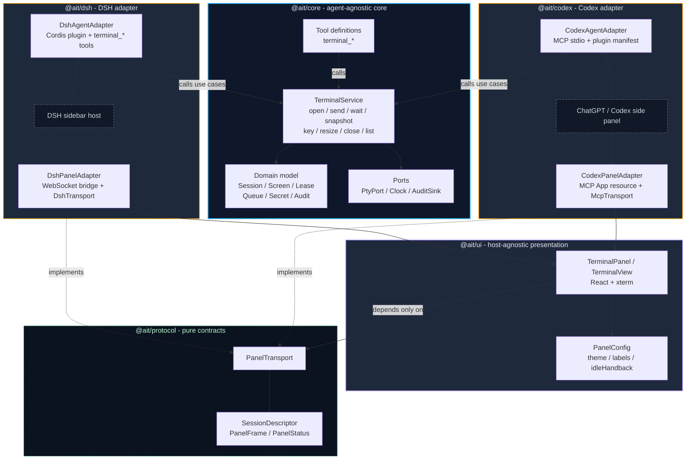
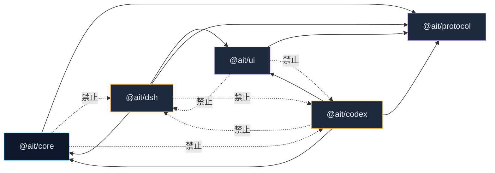
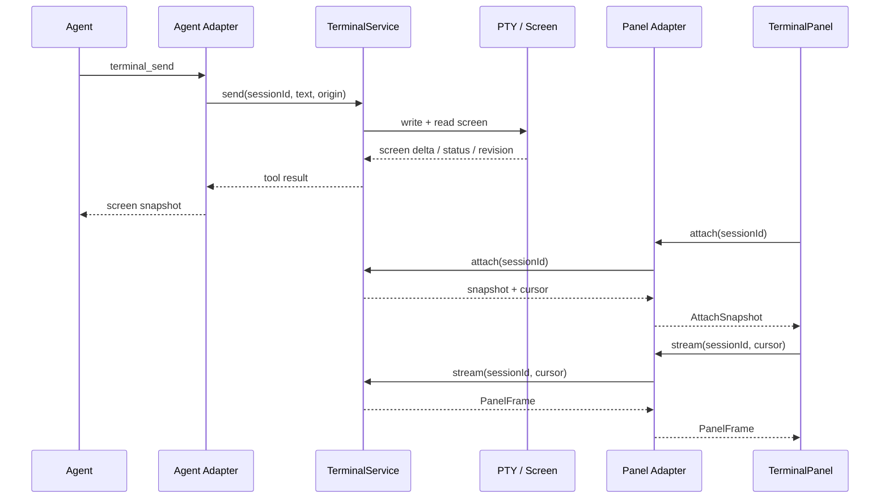

# Agent Interactive Terminal 架构设计

> 目标：一个 agent 无关的核心，两片宿主叶子。每片叶子由 **agent 侧适配器** 和 **面板侧适配器** 组成；共享 UI 只依赖面板传输接口，不依赖任何宿主。

## 1. 一句话结论

可以把它理解成“一个树干，两片叶子”：

- **树干**：`@ait/core`，会话、屏幕、PTY、租约、队列、密码、审计。
- **叶脉**：`@ait/ui`，React + xterm 的面板呈现层，只认 `PanelTransport`。
- **左叶**：`@ait/dsh`，DSH 的 Cordis 工具适配 + WebSocket 面板适配。
- **右叶**：`@ait/codex`，MCP stdio 工具适配 + MCP App 面板适配。

DSH 和 Codex 不互相 import；核心不认识 MCP、DSH、React、WebSocket。

## 2. 总体架构



## 3. 包依赖关系



规则：

- `@ait/core` 不依赖任何宿主。
- `@ait/ui` 只依赖 `@ait/protocol`，不依赖 `@ait/core` 的 Node 运行时。
- `@ait/dsh` 和 `@ait/codex` 是两片叶子，彼此不能互相 import。
- 只有叶子可以依赖宿主 SDK；核心和 UI 都不行。

## 4. 核心契约：PanelTransport

当前 `WebSocketClass`、`__AIT_FORCE_DARK__`、条件 `sessionId` 都不应该存在于共享 UI 里。它们应该被 `PanelTransport` 和 `PanelConfig` 替代。

```ts
// @ait/protocol
export interface PanelTransport {
  list(): Promise<SessionDescriptor[]>
  open(cols: number, rows: number): Promise<SessionDescriptor>
  close(sessionId: string): Promise<void>

  attach(sessionId: string): Promise<AttachSnapshot>
  stream(sessionId: string, cursor: number, signal?: AbortSignal): AsyncIterable<PanelFrame>

  write(sessionId: string, data: string): Promise<PanelStatus>
  resize(sessionId: string, cols: number, rows: number): Promise<void>
  action(sessionId: string, action: PanelAction): Promise<PanelStatus>
}

export interface PanelConfig {
  theme: 'dark' | 'light'
  labels: Record<string, string>
  idleHandbackMs: number
}
```

落地方式：

- `DshTransport implements PanelTransport`：内部用 WebSocket。
- `McpTransport implements PanelTransport`：内部用 MCP 工具。
- `TerminalPanel` 只接收 `transport` 和 `config`，不再判断宿主。
- DSH 传自己的主题和中文 labels；Codex 也传自己的配置，不再有全局开关。

## 5. 一次调用的完整链路



注意：agent 侧和面板侧走的是同一个 `TerminalService`，但不是同一个传输层。同一份会话状态，两个投影。

## 6. 目录落地

```text
packages/
  protocol/          # 纯类型：PanelTransport、SessionDescriptor、PanelFrame
  core/              # Session、Screen、Lease、Queue、Secret、Audit、TerminalService
  ui/                # React + xterm，TerminalPanel / TerminalView，PanelConfig
  dsh/               # DshAgentAdapter + DshPanelAdapter + WebSocket bridge
  codex/             # CodexAgentAdapter + CodexPanelAdapter + MCP App resource
plugins/
  codex/             # Codex 插件清单、stdio 启动器
```

对应当前仓库：

- `src/session`、`src/screen`、`src/pty`、`src/tools` → `@ait/core`
- `src/mcp` → `@ait/codex` 的 agent 侧
- `src/panel` 里的 React `TerminalView` / `TerminalPanel` → `@ait/ui`
- `src/panel/react-app.js`、`src/panel/panel.css` → `@ait/codex` 的面板侧
- `client/terminal.src.js`、`client/index.js` → `@ait/dsh`
- `plugins/codex` → `@ait/codex` 的发布壳

## 7. 迁移顺序

1. 先建 `@ait/protocol`，把 `PanelTransport`、`PanelConfig`、`PanelFrame` 定下来。
2. 把现在 `McpSocket` 改成显式 `McpTransport`，把 DSH 的 WebSocket 改成 `DshTransport`。
3. 把 `TerminalPanel` 里的 `WebSocketClass`、`__AIT_FORCE_DARK__`、条件 `sessionId` 全部删掉，只注入 `transport` 和 `config`。
4. 把 `src/panel/app.ts` 这种旧手写面板删掉，避免两套 UI 并存。
5. 最后才按包拆目录；拆分本身不改变行为，只是把边界固定下来。

## 8. 结论

一个 agent 无关的核心，两片宿主叶子；每片叶子由 agent adapter 和 panel adapter 组成；共享 UI 只依赖面板传输接口，不依赖任何宿主。

这样 DSH 和 Codex 才能共享会话、屏幕、租约和 xterm 组件，又不会因为改一个平台的 attach 方式把另一个平台弄断。
